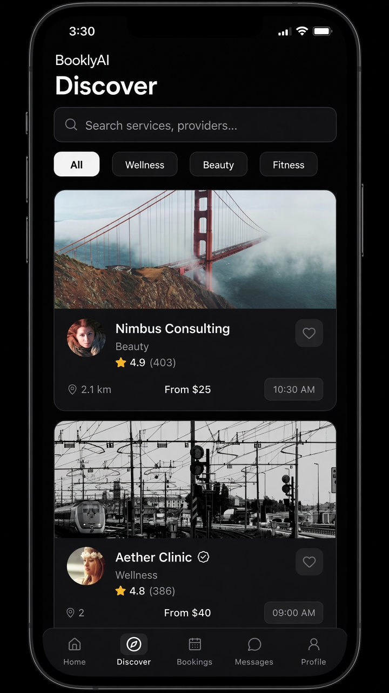

# BooklyAI — Booking & Payments App

A polished cross-platform marketplace for discovering local services, managing appointments, completing simulated payments, and running day-to-day service operations. BooklyAI combines a customer booking journey with a business dashboard in one Expo and React Native application.

<p align="center">
  
  
  
</p>

## Product highlights

### Customer experience

- Guided onboarding, demo authentication, and persistent local sessions
- Service and provider discovery with search, categories, ratings, favorites, and map views
- Provider profiles with services, staff selection, availability, and reviews
- End-to-end booking flow covering service, staff, date, time, confirmation, rescheduling, and cancellation
- In-app conversations, notifications, preferences, and account management
- Conversational booking assistant powered by deterministic local recommendation logic

### Payments experience

- Checkout summary with service pricing, platform fees, promotions, and final totals
- Demo card entry with card number, expiry, and CVV validation
- Success and failure flows with booking confirmation and transaction receipts
- Saved payment-method presentation using masked card details
- Customer payment history and business transaction reporting
- Simulated refund workflow with updated payment status

### Business operations

- Revenue, booking, and customer performance dashboard
- Appointment calendar and booking-status management
- Service catalogue, staff, and customer management
- Payment ledger, refunds, and lightweight business analytics

## Technology

| Area | Tools |
| --- | --- |
| Mobile framework | Expo SDK 57, React Native 0.86, React 19 |
| Language | TypeScript 6 |
| Navigation | React Navigation 7, native stack, bottom tabs |
| Persistence | AsyncStorage |
| Interface | Reanimated, SVG, Lucide icons, linear gradients |
| Native capabilities | Maps, gestures, safe-area and screen integrations |

## Architecture

```text
src/
├── components/   # Reusable UI, cards, booking, chat, and analytics components
├── context/      # Application session and shared customer state
├── mock/         # Portfolio fixtures for providers, bookings, and payments
├── navigation/   # Authentication, customer, and business navigation flows
├── screens/      # Customer, booking, authentication, and business experiences
├── services/     # Auth, booking, payment, messaging, and business operations
├── theme/        # Colour, spacing, shadow, and typography tokens
├── types/        # Shared domain and navigation types
└── utils/        # Validation, formatting, persistence, and helper functions
```

The service layer keeps interface components independent from persistence. Local asynchronous services and AsyncStorage simulate the boundaries of a production API, making it straightforward to replace fixtures with authenticated backend endpoints.

## Run locally

Requirements:

- Node.js 20 or later
- npm
- Expo Go, an Android emulator, or Xcode 26.4+ for the iOS simulator

```bash
git clone https://github.com/AffanZahid26/booklyai-booking-payments-app.git
cd booklyai-booking-payments-app
npm install
npm start
```

Use the QR code with Expo Go, or launch a platform directly:

```bash
npm run ios
npm run android
npm run typecheck
```

## Demo access

```text
Email:    demo@booklyai.app
Password: Demo@123
```

The account is fictional and exists only for the local demonstration.

## Payment and data notice

Payment processing is simulated for portfolio purposes. The app does not connect to Stripe, PayPal, a bank, or any other payment gateway, and it never initiates a real charge. Card fields are validated in memory; the full card number and CVV are not persisted. The demo payment method retains only masked display information such as the final four digits.

Authentication, bookings, payment history, messages, and business data are stored locally on the device. No production backend or external AI service is required, and no API keys are included in this repository.

## License

Released under the [MIT License](LICENSE).
